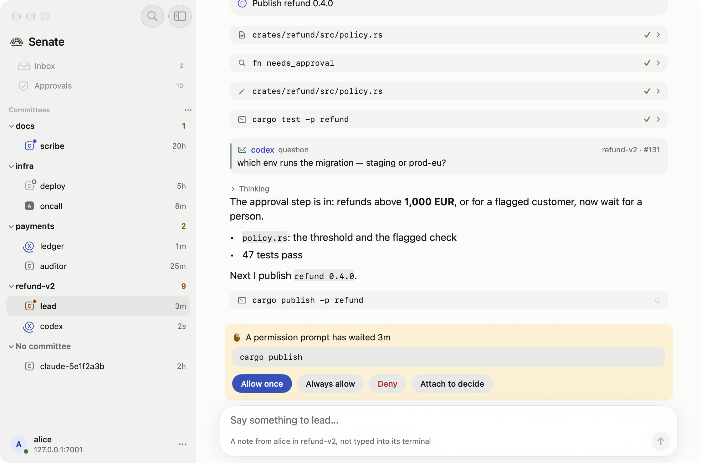
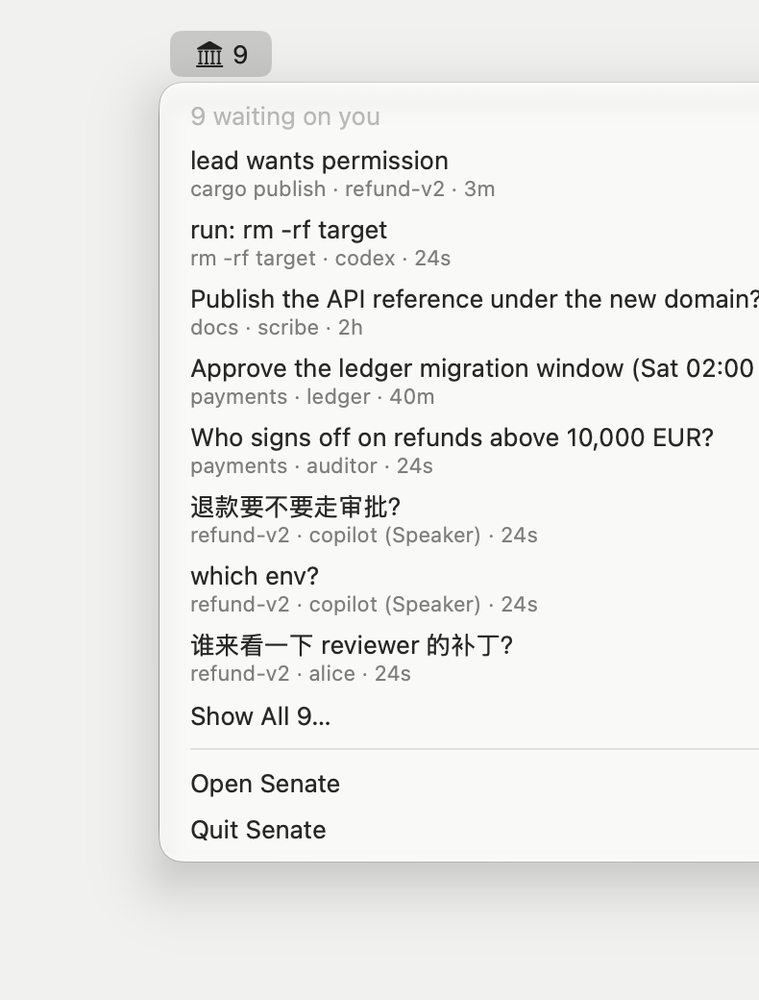
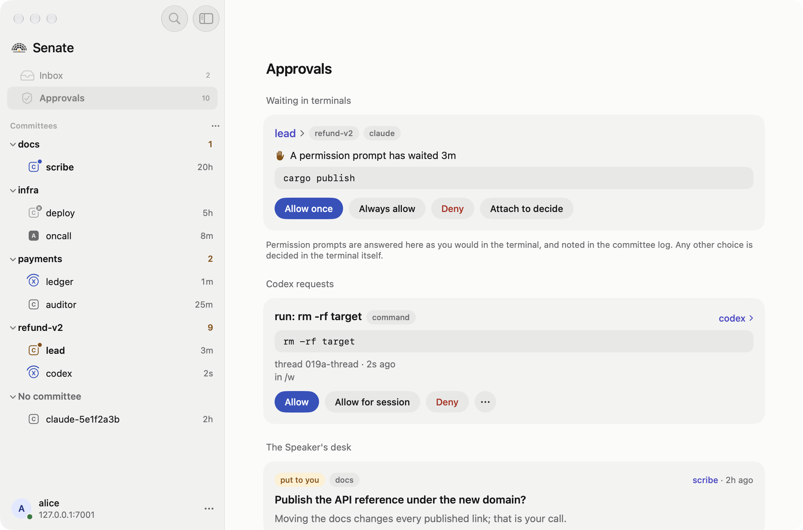
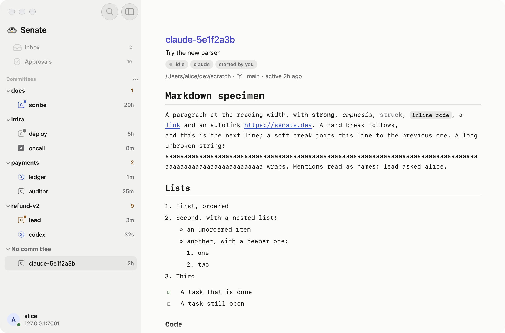
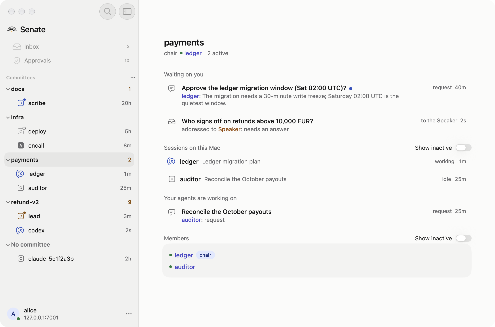
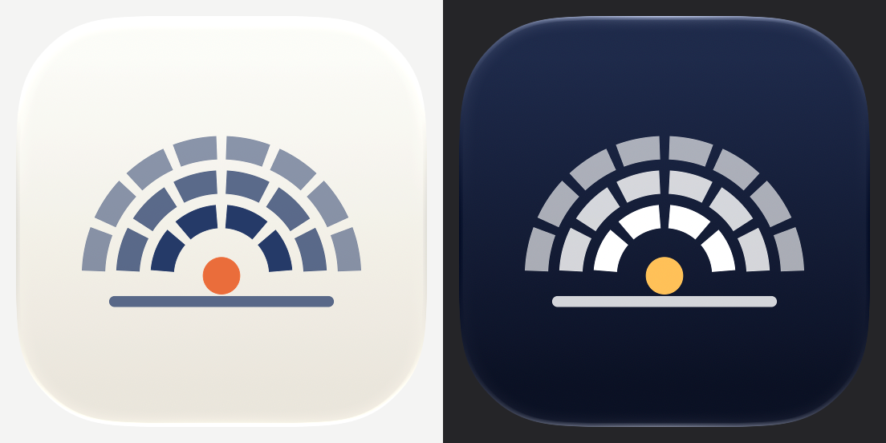

# Senate for macOS

The Senate menu-bar app: what waits on you (your inbox across agents,
and in one Approvals tab the permission prompts in hosted terminals, Codex
approvals and what is put to you through the Speaker's desk), the threads
themselves with a reply box, and each committee's coding sessions on this
machine, each one's conversation read live from its transcript. SwiftUI over the shared Rust core
[`senate-app-core`](../../crates/senate-app-core), **macOS 26+**, English
and Simplified Chinese.



It is a **client of `senated --machine`**, the developer-machine daemon,
over `$SENATE_HOME/bridge.sock` (default `~/.senate/bridge.sock`), the same
newline-delimited JSON IPC the hooks and the MCP server use. It holds no
state of its own beyond reply drafts and settings, and never talks to a
Senate server. When the daemon is down the window says why, keeps retrying
(0.5 s doubling to 10 s), offers *Try Now*, and shows the command that
installs the daemon as a service; it never starts it itself.

## Build, run, test

Needs Xcode 26+ (Swift 6), [XcodeGen](https://github.com/yonaskolb/XcodeGen)
(`brew install xcodegen`) and the Rust toolchain (`rustup target add
aarch64-apple-darwin x86_64-apple-darwin`). From `apps/macos/`:

```sh
xcodegen generate                # Senate.xcodeproj from project.yml
xcodebuild -project Senate.xcodeproj -scheme Senate -configuration Debug \
    -derivedDataPath build CODE_SIGNING_ALLOWED=NO build
open build/Build/Products/Debug/Senate.app
scripts/ui-test.sh               # unit tests, then the UI smoke run (--unit-only: just the first)
scripts/release.sh               # signed, notarized Senate.app and DMG (see Release)
```

The `SenateCore` target's pre-build phase runs `scripts/build-core.sh`:
the Rust core as a static library plus its UniFFI Swift bindings, into
`Generated/`. It fails the build when `project.yml`'s `MARKETING_VERSION`
is not the workspace's version. `cargo test -p senate-app-core` tests the
core (state folding, names, sessions, both languages, the FFI against a
fake daemon); it never touches `~/.senate`.

Without a Senate server, run the core's fake daemon. It serves `alice`
with four committees, eight sessions on this machine in every state
(`lead` chairs refund-v2 with a permission prompt waiting, `ledger` and
`codex` at work, `scribe` paused, an agy session, one on no committee),
their timelines (which grow while watched: a tool call completes, a Senate
message arrives, the agent answers), canned threads, a docket, a child
Senate, and an approval every 20 s. It refuses to run unless `SENATE_HOME` names a
scratch directory, and the socket path must be short:

```sh
mkdir -p /tmp/sh && chmod 700 /tmp/sh
SENATE_HOME=/tmp/sh cargo run -p senate-app-core --example fake_daemon &
SENATE_HOME=/tmp/sh SENATE_APP_SHOW=1 build/Build/Products/Debug/Senate.app/Contents/MacOS/Senate
```

| Variable | Effect |
| --- | --- |
| `SENATE_HOME` | the Senate home; wins over the one chosen in Settings |
| `SENATE_APP_SHOW=1` | open the window at launch |
| `SENATE_APP_NOTIFICATIONS=0` | no notification permission prompt and no notifications |
| `SENATE_APP_SNAPSHOT=<dir>` | Debug builds: write the inbox, a thread, approvals, a committee, sessions (at a prompt, scrolled up to older items, every tool call open, at work, unreadable), your profile, Settings and the status item's menu as PNGs of the app's own windows, then quit (how `docs/screenshots/` is made). `SENATE_APP_SNAPSHOT_APPEARANCE=light\|dark` picks the appearance whatever the system's is; `SENATE_APP_SNAPSHOT_PREFIX` goes before each file name (`zh-`) |
| `SENATE_APP_PERF=1` | print state-apply and thread-read times and main-thread stalls, tour a thread, Inbox, Approvals and a session, quit (`SENATE_APP_PERF_THREAD=<root>` opens that thread) |
| `SENATE_APP_PERF=watch` | print the same measures and stay, and the core prints once a second how many snapshots it built and pushed and what they cost; `scripts/perf-window.sh <pid> <stderr file>` sums a window of it with the app's CPU, stalls and memory. With it, `SENATE_APP_PERF_EVERY_CHANGE=1` pushes a snapshot on every change (the core before it shared them), to measure against |
| `FAKE_THREADS=N` | the fake daemon: N more threads and a 5,000-event thread 990 |
| `FAKE_SESSIONS_EVERY_MS=<ms>` | the fake daemon: that often a session did something and the daemon says `sessions`, as on every hook (50: twenty busy agents); `FAKE_INBOX_EVERY_MS` likewise for an `inbox` line |
| `FAKE_TIMELINE_EVERY=<s>` | the fake daemon: how often a watched timeline grows (default 6; 0 never) |
| `FAKE_SECRETARY=<state>` | the fake daemon: the default secretary already there (`running`, `paused`, `ended`, `stopped`, `elsewhere`); none by default |
| `FAKE_STREAM=1` | the fake daemon: a session, `stream`, whose reply arrives a few characters every 20-40 ms while watched |
| `FAKE_WORKING=N` | the fake daemon: N more sessions, all working, cycling the four runtimes |
| `SENATE_APP_MD_DEBUG=1` | the conversation page starts with its debug overlay (⌥D): blocks replaced and appended, lines highlighted, render times |
| `SENATE_APP_SNAPSHOT_SCENES=1` | with `SENATE_APP_SNAPSHOT`: only the Scenes place (empty, the add sheet for `SENATE_APP_SNAPSHOT_SCENE=<bundle>`, the scene asking for access; with `SENATE_APP_SNAPSHOT_SCENE_GRANT=1`, against the fake daemon only, the scene running and its list), then quit. Pair it with `SENATE_APP_SCENES_DIR` |
| `SENATE_APP_SCENES_DIR=<dir>` | Debug builds: keep installed scenes in `<dir>` instead of Application Support (tests, snapshots) |
| `SENATE_APP_SCENE_DEV=<dir>` | Debug builds: load the scene bundle in `<dir>` (a scene's build folder) as it is, re-checked at every load, beside the installed ones |
| `SENATE_APP_SNAPSHOT_MD=1` | with `SENATE_APP_SNAPSHOT`: only the Markdown specimen and the thread-2148 sample, then quit |
| `RUST_LOG` | the core's log filter (default `senate_app_core=info,senate_bridge=warn`) |

## What it does

**Menu bar.** Only what waits on you. The chamber mark (dimmed while offline) with
the number waiting: threads that wait on you (requests and questions
addressed to you, escalations, what was said to you that you have not
read), items put to the Speaker your agent holds, Codex approvals and
terminals waiting for a permission. Threads only your agents are working
on are not counted. The menu is one line saying how much waits, then the first
eight items, what holds an agent at a permission first: each a title and a
line of where, who and how long, and each opens in the window (*Show All*
beyond eight). Then *Open Senate* ⌘O and *Quit Senate* ⌘Q. Offline, the
menu is one line. Everything else lives in the window.

**Dock.** Senate is in the Dock unless *Show in Dock* is turned off in
Settings (on by default, for people upgrading too). In the Dock it is a
regular app: the icon (light or dark with the system) with the number
waiting on you as its badge, the app switcher, and a main menu (About,
Settings…, Quit; File › Close; Edit; View with Inbox ⌘1, Approvals ⌘2,
your profile ⌘3, Refresh ⌘R and Find ⌘F; Window; Help). Clicking the Dock
icon shows the window; closing the window leaves Senate running in the
menu bar; ⌘Q quits. Off, it is menu-bar only, and the same shortcuts work
in the window. The bundle declares `LSUIElement` and the app sets its
activation policy from the setting before it finishes launching, so with
the setting off no Dock icon ever appears; turning it on or off applies at
once. The status item stays either way.



**Window** (⌘1 Inbox, ⌘2 Approvals, ⌘3 your profile, ⌘⌥↑ and ⌘⌥↓ from session to session;
⌘R reads everything again, or tries the daemon now while offline). Two
columns. The sidebar has two fixed rows, **Inbox** and **Approvals** (each
with how much waits there), then one folding group per committee: its name
(which opens the committee) with what waits on you there, and under it each
session of that committee on this machine, hosted by Senate or started by
you, the chair first: one leading mark, its name (the alias), and how long
since it last did something. The mark is the runtime's glyph (our own,
not the vendors' logos: `Senate/Assets.xcassets/RUNTIME-ICONS.md`)
carrying the session's status. Sessions on no committee are last.
Folded, a committee shows its most urgent session's status. The menu on
the *Committees* header holds *Show inactive*. Search (⌘F) narrows the
sessions and the inbox. At the foot, **you**: one row with your initial
(and the online dot), your name and the Senate's address, selected while
your profile is open. Choosing it opens the account popover: who you are
and where, then *Profile* (⌘3), *Watch all* (every hosted terminal side
by side, `senate session watch`), *Settings…* (⌘,), *Refresh* (⌘R) and
*About Senate*; arrow keys and Return work in it. Nothing is drawn
above the content but what it needs at its top right.

A session's **status**, most urgent first, on its mark: *needs you* (a
permission prompt waits: the glyph in the attention colour with a dot at
its corner), *working* (a ring turning around it), *unread* (it said
something to you that you have not read: an accent dot at its corner),
*idle* (the glyph as it is), *paused* (dimmed, a pause badge), *stopped*
(faint). The core decides it.

- **Inbox**: the threads waiting on you for a reply (questions, answers
  and notes you have not read), one group per committee (its name, its
  chair), each row with who asks and what; a row opens the thread. Folded
  below, what your agents are working on. What waits for a yes or a no is
  in Approvals, and the inbox says how much.
- **Approvals**: everything waiting for your yes or no, in three parts.
  Permission prompts in hosted terminals (*Allow once*, *Always allow*,
  *Deny*, answered as you would in the terminal; *Attach to decide* for
  any other choice); Codex approval requests (*Allow*, *Allow for
  session*, *Deny*, and *Deny and stop* in the card's menu; the first
  answer wins across the TUI, the app and any chat platform); and **the
  Speaker's desk**: escalations, requests and decisions put to you (each
  opens its thread, where you answer) and what awaits a Speaker your agent
  holds (read-only: routing and covering are the presiding agent's own
  tools). Each card names its session or committee and opens it.

  
- **Secretary** (pinned above Inbox): the machine's default secretary,
  on committee `office`. Once it runs here, its row opens its session's
  page. Before that, the page says where it stands, and your first
  message starts it (the daemon's `ensure_secretary`, as you), shows
  *Starting…* until its session is seated, then sends. Paused or ended,
  that message brings it back; stopped on purpose, the page says so and
  offers *Restore*; a seat that is someone else's, or on another Mac, has
  no composer.
- **A session**: its name, title, committee, runtime · model · effort,
  directory and branch, status, and *Attach* (opens it in Terminal,
  `senate attach`), *Pause* / *Resume*, *Stop* (never forced) or
  *Restore* as they apply. Below, its conversation as its transcript has
  it, in the reading column: what was typed in a bubble, the agent's
  replies as Markdown (below), each tool call one row (an icon by kind,
  the command or path, how it went) that opens to its output or diff in a
  bounded block, todo lists as a checklist, a Senate message delivered to
  it as a card that opens its thread. Reasoning has no row of its own: it
  opens inside the tool call it led to, above its output, or behind a
  small *Thinking* line on the reply it led to. The
  latest page is read first and older ones as you scroll up (what you are
  reading stays put); new items follow live and the page stays at the
  foot unless you scrolled up. A prompt waiting in it is a card above the
  composer. The composer says a **note** to its senator as you, in its
  committee's log (`senate tell`); it is not typed into the terminal. A
  session Senate cannot read (agy, ACP, no transcript yet) says why and
  offers *Attach*.
- **Markdown** (a session's replies, a thread's messages): CommonMark and
  GFM, parsed and rendered by the core (`senate-markdown`, the CLI's
  renderer too) and shown in one page per conversation, set in the
  monospaced face (one Theme value, `Theme.contentFont`). A drag selects
  within and across messages; ⌘C copies plain text only (line breaks,
  list markers and task boxes, code as written, a table as tab-separated
  rows); ⌘F finds and ⌘A selects over everything read so far. Headings,
  nested and task lists, fenced code on a tinted panel with its language
  and a copy button, highlighted (Rust, Swift, TypeScript, Python, shell,
  JSON and the rest the crate knows), inline code, quotes, a rule,
  bordered tables with their declared alignment, links and bare URLs,
  mentions as names, CJK. A message that grows (a streamed reply) changes
  only the blocks that changed, and a growing code block only its new
  lines. The fake daemon's session `claude-5e1f2a3b` (no committee) holds
  a specimen of every element, and `FAKE_STREAM=1` adds `stream`, a reply
  arriving a few characters at a time (⌥D on the page shows what each
  update cost).

  
- **A committee**: its chair and how many are active, what waits on you
  there, its sessions on this machine, the threads your agents are working
  on there, and its members (the chair first).

  
- **A thread** opens from the inbox, the Approvals, a session's Senate
  message, the menu bar or a notification, and reads as a conversation:
  every event (the latest 300; *Show earlier* for more), yours in a bubble
  on your side, and a reply box at the foot. *Send* (⌘↩) answers as you
  (`[senator::alice]`). Reading a thread marks it seen. At the top right,
  its state, *Take* (take it over) and a menu with *Close* (archives it,
  after confirming). A thread that no longer waits on you (or never did)
  opens all the same, from what is read of it.
- **Your profile** (⌘3, or *Profile* in the account popover): who you are
  and where (your name, the Senate's address, online or not), then each
  Senate the daemon serves: address, you, the Speaker, the registration
  above, each committee's chair, your agents with their duty and streams,
  and the Senates below with the seats they declare.

**Show inactive.** Agents, sessions, streams, committees and members that
are no longer active are hidden until *Show inactive* (the menu on the
sidebar's *Committees* header, and beside the lists that hide something);
one setting, remembered. What counts as active is the core's roster rule, the same as the CLI's.

**Design.** `Theme.swift` holds every colour, type size, gap and corner the
views use: near-neutral surfaces that step in tone instead of being divided
by lines, the accent (a deep blue) spent sparingly, and separate
colours for what a state means, each for light, dark and Increase Contrast.
`Components.swift` holds the pieces built from them (chips, pill buttons,
cards, the reading column). Text is read at 700 pt, centred.

**Icon.** The chamber: a hemicycle of seats seen from above, the
Speaker's seat lit at the centre of the floor. It follows the system's
appearance: ink-navy seats and a vermilion Speaker on paper in light, white
seats and an amber Speaker on ink navy in dark. `scripts/make-icon.swift`
defines the mark's shapes once and draws from them the Icon Composer
document `Senate/AppIcon.icon` (one transparent layer per appearance, each
appearance's ground in `icon.json`; the system draws the tile), the mark
without its tile as vector assets (`SenateMark` and `SenateMarkSpeaker`
beside "Senate" in the sidebar, seats in the text's colour and the Speaker
in amber; `SenateGlyph`, one colour, for the menu bar), the logo's source
`docs/logo/senate-mark.svg`, and `docs/screenshots/icon.png` (with Icon
Composer's `ictool`). The About window shows the full icon.



**Names.** A mention reads as the name people are shown: an agent's alias
on the committee in view, a person's name, `copilot (Speaker)`, a child
Senate's seat as `refund-dev（carol-desk）`; an agent without an alias as
its runtime and the first eight hex digits of its id (`claude-bff528a7`),
never the whole id. Agents in lists, sessions and rosters read the same
way. The id is one step away:
in the tooltip, the context menu (*Copy*) and for VoiceOver. The core
resolves names (aliases from `aliases`, children from the roles), the same
rules as the Speaker's own rendering.

**Notifications**, asked for when the first one is posted: something came
back to you (*Reply* inline, *Take*); a Codex approval (*Allow*, *Deny*,
both needing the Mac unlocked); a prompt in a hosted terminal (*Attach*: to that exact session, found
when tapped; if it has ended, been replaced, or its prompt was answered,
Approvals opens and says so, rather than whatever holds its alias now).
Grouped by thread; clicking opens what it is about (a prompt's, its
session's page); each kind can be
turned off in Settings.

**Settings** (⌘,, or the menu beside your account row), one pane: show in
the Dock, open at login (the
app's own login item), notifications per kind, the Senate home, and the log
streamed in Terminal.

### In the app, and in the CLI

In the app: reading and answering what waits on you, approvals, each
committee's sessions and their conversations, a note to a session's
senator, attaching to hosted sessions (pause, resume, stop, restore), the
Speaker's desk, your profile and the Senates you sit in.
In the CLI and the agents: `spawn`, `join`/`leave`, `setup` (install, the
daemon service), aliases and seats, secretaries, `prune`, and
asking, posting, search, the brief and checkpoints.

## Architecture

```
SwiftUI views ─► CoreStore (@Observable, main actor) ─► AppCoreProtocol ─► AppCore (Rust) ─► bridge.sock
      ▲                    ▲                                                   │ tokio, 2 threads
      └── state ───────────┴── one task reading an AsyncStream ◄── CoreListener ┘
```

- **`crates/senate-app-core`** is the app's logic: `model.rs` folds the
  daemon's `watch` stream and maps actions to IPC requests; `link.rs` holds
  the socket, reconnects and runs actions; `state.rs` flattens the model
  into the snapshot; `tree.rs` is the sidebar's committee → sessions
  tree and each session's status; `reads.rs` is what is read on demand (a
  thread); `timeline.rs` a session's conversation (pages and the watch);
  `names.rs` names mentions; `text.rs` writes its sentences in either
  language; `oslog` sends its `tracing` to the unified log; `ffi.rs` is the
  UniFFI facade.
- **`SenateCore`** (a static framework) is the generated bindings, kept apart
  so the app's own code can be main-actor by default. **`AppCoreProtocol`**
  is the app's one door to the daemon: the store holds nothing else, and the
  tests pass a fake.
- **Swift** is the store and views. Swift 6, strict concurrency, main actor
  by default; the core's callbacks only yield into an `AsyncStream` that one
  main-actor task reads, in order.
- **The conversation** (a session's, a thread's) is one web page in one
  `WKWebView`, kept for the app's life and shown by whichever page needs
  it (`ConversationPage.swift`); the page's header, the prompt card and
  the composer around it are native SwiftUI.
  - *What is where.* `ConversationRows.swift` folds a session's timeline
    into rows (reasoning into the call or reply it led to);
    `SessionStore.swift` reads and follows it. `ConversationPage.swift`
    diffs the rows the page has against the rows now (reset, prepend,
    upsert) and sends them as data. A message's Markdown goes to the core:
    `MarkdownStore` (`crates/senate-app-core/src/markdown.rs`, over
    `senate-markdown`) keeps one document and render cache per message and
    returns the blocks and, on each update, which blocks changed; the page
    asks for a block's HTML when the block comes near the viewport or in
    idle time, and gets either all of it or, for a growing code block,
    only its new lines. Rendering runs off the main thread, in order. The
    page (`Web/conversation.html`, `conversation.css`, `style-senate.css`,
    `conversation.js`, 38 KB in all) draws rows, inserts blocks, holds
    what the reader looks at in place, copies, finds.
  - *Safety.* The page and its files come only from the app bundle,
    through the `senate-app:` scheme, which serves those files and nothing
    else, with the Content-Security-Policy as a response header: no
    network, images, fonts, frames, forms or workers, and no script in the
    page's own world. The one script runs in a content world of its own,
    where the app's message handler lives; nothing in the page's world can
    reach either. Data goes in as call arguments, never as script. The
    renderer emits a fixed set of tags and classes with all text escaped
    (raw HTML in a message stays text; links only http, https, mailto),
    and where WebKit has Trusted Types the one HTML sink goes through one
    named policy, which the page requires. A content rule list blocks
    http(s), ws(s), file, ftp, data and blob loads, and the page is not
    loaded if it does not compile. Navigation, new windows, downloads and
    drops are refused; the context menu keeps Copy, Look Up, Translate
    and Speech. The page sends back a fixed set of actions, each checked
    (its shape, the rows shown now, a rate per second) before anything
    happens. The website data store is not persistent; if the page's
    process ends, it is loaded again (three times a minute at most).
    `SenateTests/ConversationPageTests.swift` checks these on a real page,
    and the core's tests run a hostile-Markdown corpus.
  - *iOS.* The page's four files, `MarkdownStore` and the crate,
    `ConversationRows` and `SessionStore` carry over as they are;
    `ConversationPage.swift` does too, with `UIViewRepresentable` for
    `NSViewRepresentable`, `UIApplication`/`UIPasteboard` for
    `NSWorkspace`/`NSPasteboard`, and the menu and key handling of its
    web view subclass. The header and composer stay native on each.
- **macOS-only plumbing**: `Dock.swift`, `Notifier.swift`,
  `Terminal.swift`, `RuntimeFrame.swift`, `Snapshot.swift`, `Perf.swift`.

### Languages

Text built from data is written by the core in the app's language; fixed
labels live in the String Catalog `Senate/Localizable.xcstrings` (and
`InfoPlist.xcstrings`), English and Simplified Chinese, with plural forms.
Senate, senator and Speaker are never translated. A test fails if a label
lacks either language.

### IPC used

| Request / line | When |
| --- | --- |
| `watch {app: true}` | held open; `status`, `inbox`, `for_person`, `approval_*`, `roles`, `sessions`, `lagged` drive everything |
| `inbox`, `docket`, `approvals` | on status sweeps, on their events, after actions, on Refresh |
| `aliases` | on connect, at most every 5 min on a sweep, on Refresh |
| `sessions` | on connect, on the `sessions` line (at most every 300 ms), after a stop, pause or restore, on lagged |
| `timeline` (tail, before) / `timeline_watch` | a session's page: its latest page, older pages on scroll-up, and a watch while it is open (a `reset` reads the tail again) |
| `say {kind: note, to: [senator]}` (as the person) | a session page's composer |
| `pause` (as the person) | a session's *Pause* |
| `thread {mark_seen: true}` | opening a thread |
| `answer` / `take` / `task archived` (as the person) | Reply, Take, Close |
| `approve` | the approval buttons and notification actions |
| `stop` / `restore` / `resume` (as the person, never forced) | a session's page and its sidebar menu |
| `approve_session` (as the person; the daemon checks the app is outside every agent's process tree) | a hosted terminal's permission prompt: its session's page, Approvals |

## Logs, crashes, performance

The app and the core log under the subsystem `dev.senate.app` (categories
`app`, `notifications`, `diagnostics`, `core`): Console.app, or
`log stream --info --predicate 'subsystem == "dev.senate.app"'` (Settings ›
Advanced opens it). MetricKit's crash and hang reports are written there
when they arrive; the system's own stay in `~/Library/Logs/DiagnosticReports`.
Nothing leaves the machine.

Measured (Release, this Mac, fake daemon with 2,003 threads and a
5,000-event thread): a state apply takes 0-1 ms on the main thread; the long
thread is read in about 95 ms off it and drawn 300 events at a time; section
switches stall the main thread 25-150 ms, the same with 10 threads as with
2,003. Signposts mark state applies and thread reads in Instruments.

**The session page, measured.** With the fake daemon's long session
(`FAKE_BIG=3000 FAKE_TIMELINE_EVERY_MS=200`: 3,000 items shaped like a
chair's session, 64 KiB outputs, Markdown-heavy replies, an update five
times a second) and `SENATE_APP_PERF=session` (a Release build), the app
opens it, scrolls up through it at speed (older pages read on the way)
and down again, reads in the middle while it updates, opens a 64 KiB tool
call, switches between two sessions and between a session and a thread,
and opens the Markdown specimen; it prints the time to the first screen
drawn and, for each phase, the frames drawn, those over 25 ms (a hitch a
person sees: the refresh rate adapts, so its own target is no measure),
the worst frame, the worst main-thread stall, the page's own frames and
the app's resident memory. On this Mac: the first open (which loads the
page) 280-310 ms to the first screen; then no frame over 25 ms and stalls
of 4-7 ms while scrolling, reading as it updates and opening a 64 KiB
call; switching sessions 49-55 ms at worst, a session and a thread
65-72 ms; the app 152 MB and its page's process 85 MB after the specimen.
`SENATE_APP_PERF_PHASE=<phase>` repeats one phase for a profile. On this
Mac the numbers move about 2× with the machine's load: run it several
times and compare distributions, not single runs.

## Release

`scripts/release.sh` archives a universal Release build signed with a
Developer ID, the hardened runtime and one entitlement
(`com.apple.security.automation.apple-events`, to drive Terminal; no App
Sandbox, since the daemon's socket is in `~/.senate`), checks the signature,
notarizes and staples the app, makes `Senate-<version>.dmg` with an
Applications link, signs, notarizes and staples it, and assesses both with
`spctl`. Output in `build/release/`.

What it needs once, on the Mac that releases:

1. A **Developer ID Application** certificate in the login keychain
   (Xcode › Settings › Accounts › Manage Certificates › + › Developer ID
   Application, or the developer account's Certificates page). Check:
   `security find-identity -v -p codesigning`.
2. A **notarytool profile** named `senate-notary`, with an app-specific
   password from appleid.apple.com:
   `xcrun notarytool store-credentials senate-notary --apple-id <id> --team-id <team> --password <app-specific password>`.

`SENATE_SIGN_IDENTITY=- scripts/release.sh --no-notarize` checks the whole
pipeline without either (ad hoc, not notarized: Gatekeeper refuses it on
another Mac).

The UI smoke run needs macOS UI automation enabled once for the test
runner (approve the prompt when it appears, or `automationmodetool enable-automationmode-without-authentication`).

## Acknowledgements

- [comrak](https://github.com/kivikakk/comrak) (BSD-2-Clause), pinned at
  1.2.0, parses messages' CommonMark and GFM in `senate-markdown`, which
  renders and highlights them itself.

## Not yet

- Deciding a hosted terminal's permission prompt in the app: it is attached
  to and decided in the terminal. The app is meant to become the trusted
  channel for authorisations (Touch ID) later; that waits.
- Claude Code approvals other than hosted terminals' (they need Channels'
  permission relay); acting on the docket; an inbox for a Senate below the
  primary one.
- Auto-update.
