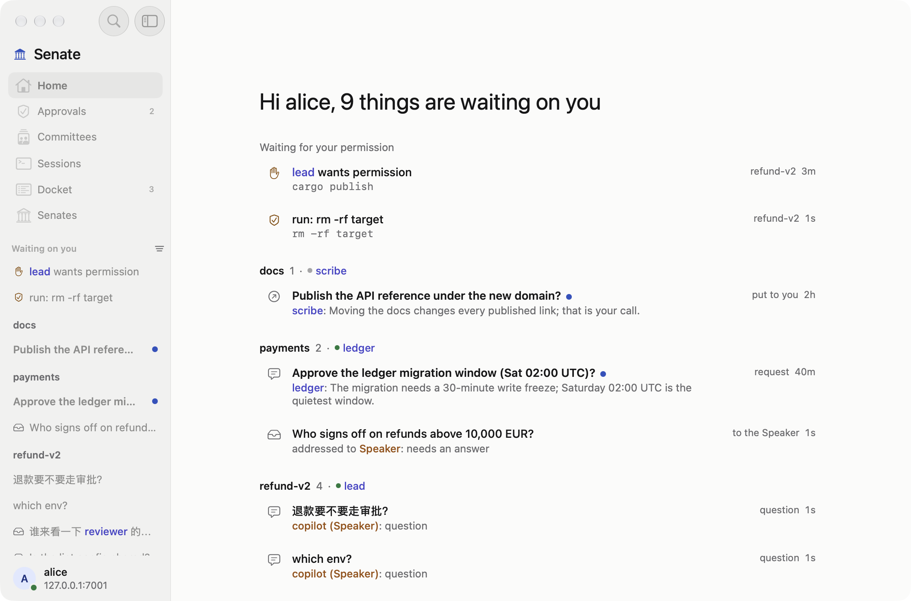
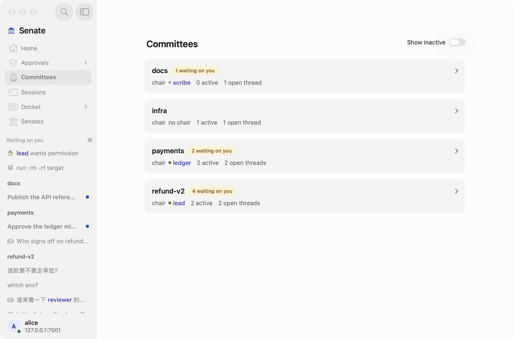

# Senate for macOS

The Senate menu-bar app: what waits on you (your inbox across agents,
Codex approvals, permission prompts in hosted terminals), the threads
themselves with a reply box, this machine's hosted sessions, the docket of
a Senate one of your agents presides over, and the Senates your machine
serves. SwiftUI over the shared Rust core
[`senate-app-core`](../../crates/senate-app-core), **macOS 26+**, English
and Simplified Chinese.



It is a **client of `senated --machine`**, the developer-machine daemon,
over `$SENATE_HOME/bridge.sock` (default `~/.senate/bridge.sock`), the same
newline-delimited JSON IPC the hooks and the MCP server use. It holds no
state of its own beyond reply drafts and settings, and never talks to a
Senate server. When the daemon is down the window says why, keeps retrying
(0.5 s doubling to 10 s), offers *Try Now*, and shows the command that
installs the daemon as a service; it never starts it itself.

## Build, run, test

Needs Xcode 26+ (Swift 6), [XcodeGen](https://github.com/yonaskolb/XcodeGen)
(`brew install xcodegen`) and the Rust toolchain (`rustup target add
aarch64-apple-darwin x86_64-apple-darwin`). From `apps/macos/`:

```sh
xcodegen generate                # Senate.xcodeproj from project.yml
xcodebuild -project Senate.xcodeproj -scheme Senate -configuration Debug \
    -derivedDataPath build CODE_SIGNING_ALLOWED=NO build
open build/Build/Products/Debug/Senate.app
scripts/ui-test.sh               # unit tests, then the UI smoke run (--unit-only: just the first)
scripts/release.sh               # signed, notarized Senate.app and DMG (see Release)
```

The `SenateCore` target's pre-build phase runs `scripts/build-core.sh`:
the Rust core as a static library plus its UniFFI Swift bindings, into
`Generated/`. It fails the build when `project.yml`'s `MARKETING_VERSION`
is not the workspace's version. `cargo test -p senate-app-core` tests the
core (state folding, names, sessions, both languages, the FFI against a
fake daemon); it never touches `~/.senate`.

Without a Senate server, run the core's fake daemon. It serves `alice`
with `claude` (alias `lead`, presiding, a hosted terminal with a waiting
permission prompt) and `codex`, canned threads, a docket, a child Senate,
and an approval every 20 s. It refuses to run unless `SENATE_HOME` names a
scratch directory, and the socket path must be short:

```sh
mkdir -p /tmp/sh && chmod 700 /tmp/sh
SENATE_HOME=/tmp/sh cargo run -p senate-app-core --example fake_daemon &
SENATE_HOME=/tmp/sh SENATE_APP_SHOW=1 build/Build/Products/Debug/Senate.app/Contents/MacOS/Senate
```

| Variable | Effect |
| --- | --- |
| `SENATE_HOME` | the Senate home; wins over the one chosen in Settings |
| `SENATE_APP_SHOW=1` | open the window at launch |
| `SENATE_APP_NOTIFICATIONS=0` | no notification permission prompt and no notifications |
| `SENATE_APP_SNAPSHOT=<dir>` | Debug builds: write home, a thread, each section, Settings and the status item's menu as PNGs of the app's own windows, then quit (how `docs/screenshots/` is made). `SENATE_APP_SNAPSHOT_APPEARANCE=light\|dark` picks the appearance whatever the system's is; `SENATE_APP_SNAPSHOT_PREFIX` goes before each file name (`zh-`) |
| `SENATE_APP_PERF=1` | print state-apply and thread-read times and main-thread stalls, tour the sections, quit (`SENATE_APP_PERF_THREAD=<root>` opens that thread) |
| `FAKE_THREADS=N` | the fake daemon: N more threads and a 5,000-event thread 990 |
| `RUST_LOG` | the core's log filter (default `senate_app_core=info,senate_bridge=warn`) |

## What it does

**Menu bar.** Only what waits on you. The icon (filled when online) with
the number waiting: threads that wait on you (requests and questions
addressed to you, escalations, what was said to you that you have not
read), items put to the Speaker your agent holds, Codex approvals and
terminals waiting for a permission. Threads only your agents are working
on are not counted. The menu is one line saying how much waits, then the first
eight items, what holds an agent at a permission first: each a title and a
line of where, who and how long, and each opens in the window (*Show All*
beyond eight). Then *Open Senate* ⌘O and *Quit Senate* ⌘Q. Offline, the
menu is one line. Everything else lives in the window. Menu bar only
(`LSUIElement`).


**Window** (⌘1–6 for the sections; ⌘R reads everything again, or tries the
daemon now while offline). Two columns. The sidebar has the sections, then
*Waiting on you*: permissions first, then each committee under its name
with its threads and docket items as one-line rows (a dot while unread),
searched (⌘F) and narrowed to an agent there; below, folded, *With your
agents*: the threads your agents are still working on. At its foot, who you are and
the Senate's address; its menu opens *Settings…* and *About Senate*.
Nothing is drawn above the content but what it needs at its top right.

- **Home**: everything waiting on you, the same list as the menu bar's:
  permissions, then one group per committee (its name, its chair, live or
  not), each row with who asks (by alias) and what. A row opens what it
  names; a committee's name opens the committee. Folded below, what your
  agents are working on.
- **Committees**: every committee of the Senate, a card each: its chair
  by alias with a live dot, how many members are active, its open threads
  and what waits on you there. A card opens the committee: what waits on
  you there, your agents' threads there, and its members (the chair
  first). Committees with no one active and nothing for you are hidden.

  
- **A thread** opens from the sidebar, home, the menu bar or a notification
  and reads as a conversation: every event (the latest 300; *Show earlier*
  for more), yours in a bubble on your side, and a reply box at the foot.
  *Send* (⌘↩) answers as you (`[senator::alice]`). Reading a thread marks it
  seen. At the top right, its state, *Take* (take it over) and a menu with
  *Close* (archives it, after confirming). Once answered it no longer waits
  on you and leaves the sidebar. Drafts outlive the app.
- **Approvals**: one card per request. Permission prompts waiting in hosted
  terminals (*Allow once*, *Always allow*, *Deny*, answered as you would in
  the terminal; *Attach to decide* for any other choice), and Codex
  approval requests (*Allow*, *Allow for session*, *Deny*, and *Deny and
  stop* in the card's menu; the first answer wins across the TUI, the app
  and any chat platform).
- **Sessions**: this machine's hosted sessions (committee, runtime, model,
  uptime, attached, paused, a waiting prompt): *Attach* opens it in Terminal
  (`senate attach`), *Stop* (never forced), *Resume* and *Restore*; *Watch
  all* (`senate session watch`) at the top right. Below, the Codex threads,
  *Open in Terminal*.
- **Docket** (while one of your agents presides): what awaits that Speaker.
  Read-only: routing and covering are the presiding agent's own tools.
- **Senates**: address, you, the Speaker, the registration above, each
  committee's chair, your agents with their duty and streams, and the
  Senates below with the seats they declare.

**Show inactive.** Agents, hosted sessions, Codex threads, streams,
committees and members that are no longer active are hidden until *Show
inactive* (at the top right of Committees, Sessions and Senates, and in the
sidebar's agent filter); one setting, remembered. What counts as active is
the core's roster rule, the same as the CLI's.

**Design.** `Theme.swift` holds every colour, type size, gap and corner the
views use: near-neutral surfaces that step in tone instead of being divided
by lines, the accent (the blue of the icon) spent sparingly, and separate
colours for what a state means, each for light, dark and Increase Contrast.
`Components.swift` holds the pieces built from them (chips, pill buttons,
cards, the reading column). Text is read at 700 pt, centred.

**Names.** A mention reads as the name people are shown: an agent's alias
on the committee in view, a person's name, `copilot (Speaker)`, a child
Senate's seat as `refund-dev（carol-desk）`; an agent without an alias as
its runtime and the first eight hex digits of its id (`claude-bff528a7`),
never the whole id. Agents in lists, sessions and rosters read the same
way. The id is one step away:
in the tooltip, the context menu (*Copy*) and for VoiceOver. The core
resolves names (aliases from `aliases`, children from the roles), the same
rules as the Speaker's own rendering.

**Notifications**, asked for when the first one is posted: something came
back to you (*Reply* inline, *Take*); a Codex approval (*Allow*, *Deny*,
both needing the Mac unlocked); a prompt in a hosted terminal (*Attach*: to that exact session, found
when tapped; if it has ended, been replaced, or its prompt was answered,
Sessions opens and says so, rather than whatever holds its alias now).
Grouped by thread; clicking opens what it is about; each kind can be
turned off in Settings.

**Settings** (⌘,, or the sidebar's foot), one pane: open at login (the
app's own login item), notifications per kind, the Senate home, and the log
streamed in Terminal.

### In the app, and in the CLI

In the app: reading and answering what waits on you, approvals, seeing and
attaching to hosted sessions (stop, restore), the docket, the Senates.
In the CLI and the agents: `spawn`, `join`/`leave`, `setup` (install, the
daemon service), aliases and seats, secretaries, `prune`, and
asking, posting, search, the brief and checkpoints.

## Architecture

```
SwiftUI views ─► CoreStore (@Observable, main actor) ─► AppCoreProtocol ─► AppCore (Rust) ─► bridge.sock
      ▲                    ▲                                                   │ tokio, 2 threads
      └── state ───────────┴── one task reading an AsyncStream ◄── CoreListener ┘
```

- **`crates/senate-app-core`** is the app's logic: `model.rs` folds the
  daemon's `watch` stream and maps actions to IPC requests; `link.rs` holds
  the socket, reconnects and runs actions; `state.rs` flattens the model
  into the snapshot; `reads.rs` is what is read on demand (a thread);
  `names.rs` names mentions; `text.rs` writes its sentences in either
  language; `oslog` sends its `tracing` to the unified log; `ffi.rs` is the
  UniFFI facade.
- **`SenateCore`** (a static framework) is the generated bindings, kept apart
  so the app's own code can be main-actor by default. **`AppCoreProtocol`**
  is the app's one door to the daemon: the store holds nothing else, and the
  tests pass a fake.
- **Swift** is the store and views. Swift 6, strict concurrency, main actor
  by default; the core's callbacks only yield into an `AsyncStream` that one
  main-actor task reads, in order.

### Languages

Text built from data is written by the core in the app's language; fixed
labels live in the String Catalog `Senate/Localizable.xcstrings` (and
`InfoPlist.xcstrings`), English and Simplified Chinese, with plural forms.
Senate, senator and Speaker are never translated. A test fails if a label
lacks either language.

### IPC used

| Request / line | When |
| --- | --- |
| `watch {app: true}` | held open; `status`, `inbox`, `for_person`, `approval_*`, `roles`, `sessions`, `lagged` drive everything |
| `inbox`, `docket`, `approvals` | on status sweeps, on their events, after actions, on Refresh |
| `aliases` | on connect, at most every 5 min on a sweep, on Refresh |
| `sessions` | on connect, on the `sessions` line, after a stop or restore, on lagged |
| `thread {mark_seen: true}` | opening a thread |
| `answer` / `take` / `task archived` (as the person) | Reply, Take, Close |
| `approve` | the approval buttons and notification actions |
| `stop` / `restore` (as the person, never forced) | Sessions |
| `approve_session` (as the person; the daemon checks the app is outside every agent's process tree) | a hosted terminal's permission prompt: Sessions, Approvals |

## Logs, crashes, performance

The app and the core log under the subsystem `dev.senate.app` (categories
`app`, `notifications`, `diagnostics`, `core`): Console.app, or
`log stream --info --predicate 'subsystem == "dev.senate.app"'` (Settings ›
Advanced opens it). MetricKit's crash and hang reports are written there
when they arrive; the system's own stay in `~/Library/Logs/DiagnosticReports`.
Nothing leaves the machine.

Measured (Release, this Mac, fake daemon with 2,003 threads and a
5,000-event thread): a state apply takes 0-1 ms on the main thread; the long
thread is read in about 95 ms off it and drawn 300 events at a time; section
switches stall the main thread 25-150 ms, the same with 10 threads as with
2,003. Signposts mark state applies and thread reads in Instruments.

## Release

`scripts/release.sh` archives a universal Release build signed with a
Developer ID, the hardened runtime and one entitlement
(`com.apple.security.automation.apple-events`, to drive Terminal; no App
Sandbox, since the daemon's socket is in `~/.senate`), checks the signature,
notarizes and staples the app, makes `Senate-<version>.dmg` with an
Applications link, signs, notarizes and staples it, and assesses both with
`spctl`. Output in `build/release/`.

What it needs once, on the Mac that releases:

1. A **Developer ID Application** certificate in the login keychain
   (Xcode › Settings › Accounts › Manage Certificates › + › Developer ID
   Application, or the developer account's Certificates page). Check:
   `security find-identity -v -p codesigning`.
2. A **notarytool profile** named `senate-notary`, with an app-specific
   password from appleid.apple.com:
   `xcrun notarytool store-credentials senate-notary --apple-id <id> --team-id <team> --password <app-specific password>`.

`SENATE_SIGN_IDENTITY=- scripts/release.sh --no-notarize` checks the whole
pipeline without either (ad hoc, not notarized: Gatekeeper refuses it on
another Mac).

The UI smoke run needs macOS UI automation enabled once for the test
runner (approve the prompt when it appears, or `automationmodetool enable-automationmode-without-authentication`).

## Not yet

- Deciding a hosted terminal's permission prompt in the app: it is attached
  to and decided in the terminal. The app is meant to become the trusted
  channel for authorisations (Touch ID) later; that waits.
- Claude Code approvals other than hosted terminals' (they need Channels'
  permission relay); acting on the docket; an inbox for a Senate below the
  primary one.
- Auto-update.
